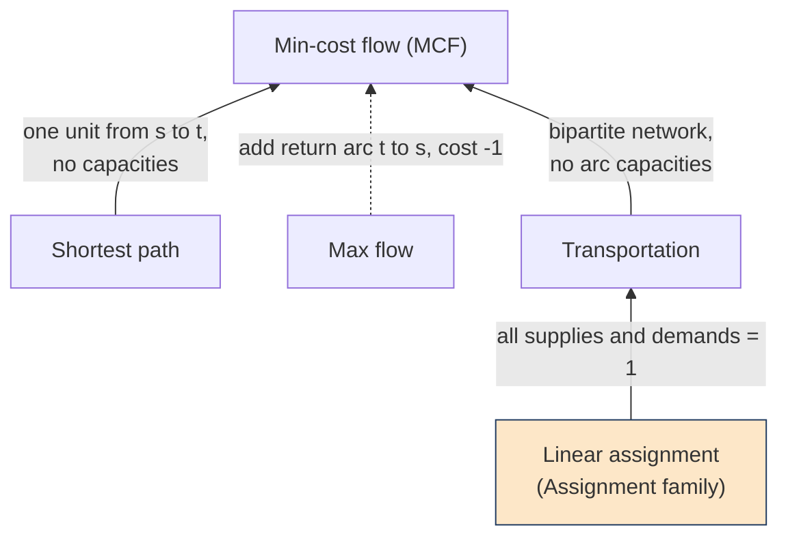

# Flow family

## Model

Every problem in this family is solved as a **minimum-cost flow (MCF)**; the
other problems are special cases obtained by fixing parameters (see the
reduction map below).

**Data.** A directed graph with nodes $V$ and arcs $A$. Each arc $(i,j) \in A$
has a cost $c_{ij}$ and a capacity $u_{ij}$. Each node $i \in V$ has a supply
$b_i$ (negative means demand), with $\sum_{i \in V} b_i = 0$.

**Variables.** $x_{ij} \ge 0$ is the flow on arc $(i,j)$.

**Formulation.**

$$
\min \sum_{(i,j) \in A} c_{ij} x_{ij}
$$

**(1)** flow conservation at every node:

$$
\sum_{j : (i,j) \in A} x_{ij} - \sum_{j : (j,i) \in A} x_{ji} = b_i \quad \forall i \in V
$$

**(2)** capacities:

$$
0 \le x_{ij} \le u_{ij} \quad \forall (i,j) \in A
$$

The constraint matrix is a network matrix (totally unimodular), so for integer
supplies and capacities the LP has an integral optimal solution. All variables
therefore have `type` `real` and no branch-and-bound is ever needed.

## Reduction map

An arrow A to B means "A is a special case of B": every instance of A is an
instance of B after fixing some parameters. Solid arrow: fixing parameters.
Dashed arrow: needs a small added arc. Linear assignment belongs to the
Assignment family.



| Arrow | Fixing | Why it is a special case |
|---|---|---|
| Shortest path to MCF | $b_s = 1$, $b_t = -1$, all other supplies 0, no capacity limits | one unit of flow from $s$ to $t$ follows a single path, so the minimum cost is the shortest path length (needs no negative-cost cycle) |
| Transportation to MCF | bipartite network: supply nodes, demand nodes, arcs only from supply to demand, no capacities | the transportation problem is exactly min-cost flow on this network |
| Linear assignment to Transportation | $n$ sources and $n$ sinks, every supply and demand = 1 | with unit supplies the optimal flow is integral, so each source sends its unit to one sink: a perfect matching of minimum cost |
| Max flow to MCF (dashed) | add an arc $t \to s$ with cost $-1$ and infinite capacity; all other costs 0, all supplies 0 | every unit sent around the cycle through $t \to s$ earns $-1$, so minimising cost maximises the flow value. This adds an arc, so it is a small construction, not only a choice of parameters |

The generator and the converters apply exactly these reductions, and the tests
check each one against an independent method (Dijkstra, Edmonds-Karp, a
directly built LP).

## Instance encoding

`shared/formats` instance layout, `family` is `flow`, `sense` is `min`:

* one `real` variable `x_i_j` per arc, `objective` = cost $c_{ij}$ (nodes are numbered from 1);
* one equality row `node_i` per node: out-flow minus in-flow `==` $b_i$;
* one row `cap_i_j`: `x_i_j <= u_ij` per capacitated arc (uncapacitated arcs have no row).

Capacities are rows, not variable bounds, because the shared format has no
bounds field. The row operator `==` for equalities is my choice and needs
confirming against the frozen format. `meta.objective_sign` is $-1$ for the
max-flow reduction: original value = sign times objective.

The restricted pip Gurobi license allows 2000 variables and 2000 constraints,
and the capacity rows count: keep $n + |\text{capacitated arcs}| \le 2000$.

## Pipeline

```
generate/generate.py ─────► data/instances/*.json ──► labels/make_labels.py ──► data/labels/*.label.json
download_instances.py ─► instances/dimacs/* ─► labels/dimacs_to_json.py ─┘
```

`data/` and `instances/` are git-ignored; never commit downloaded files.

### Generate

```sh
cd families/flow
python3 generate/generate.py --type mcf --n 50 --m 200 --seed 42 --out data/instances/a.json
python3 generate/generate.py --type transportation --n 20 --seed 1 --count 10 --out-dir data/instances
python3 generate/generate.py --type max-flow --n 100 --m 500 --seed 7 --out data/instances/mf.json
```

| `--type` | network | supplies | capacities | costs |
|---|---|---|---|---|
| `mcf` | backbone cycle plus random arcs, `--m` arcs in total (default 4n) | `n/10` sources and sinks, total `--supply-total` | backbone: total supply; others uniform in [1, `--max-cap`] | backbone `2*max-cost`; others uniform in [1, `--max-cost`] |
| `transportation` | complete bipartite, `n/2` sources and the rest sinks | random split of the total, same on both sides | none | uniform in [1, `--max-cost`] |
| `shortest-path` | backbone path 1 to n plus random arcs | $b_1 = 1$, $b_n = -1$ | none | uniform in [1, `--max-cost`] |
| `max-flow` | backbone path 1 to n plus random arcs, plus return arc n to 1 | all 0 | uniform in [1, `--max-cap`], return arc none | 0, return arc $-1$ |

The backbones keep every instance feasible (and max-flow bounded). The same
arguments always give a byte-identical file. Tests: `python3 -m unittest -v
test_generate` inside `generate/`.

### Label

```sh
python3 labels/make_labels.py data/instances
python3 labels/make_labels.py data/instances --method 2 --time-limit 60
```

Needs `gurobipy`. One `<id>.label.json` per instance:

| key | content |
|---|---|
| `variables`, `constraints` | names; every vector below follows this order |
| `lp_relaxation` | the solve: `status`, `objective`, `x`, `reduced_costs`, `duals` (node potentials for `node_i`, capacity duals for `cap_i_j`), `slacks`, `iterations`, `time_s`, `time_limit_hit` |
| `mip` | always `null` (no integer variables); kept so the layout matches the knapsack labels |
| `original_objective` | objective mapped back to the original problem (max-flow value, shortest path length, ...) |
| `gurobi`, `instance_sha256` | version, parameters (threads=1, seed=0, dual simplex by default) and a hash of the instance file |

There are no improving solutions to record: simplex has no sequence of
feasible incumbents. Sign convention (minimisation): capacity duals are
$\le 0$, node duals are free, the reduced cost of arc $(i,j)$ is
$c_{ij} - \pi_i + \pi_j - \mu_{ij}$ ($\mu$ = capacity dual, 0 if uncapacitated)
and the optimum equals $\sum_i \pi_i b_i + \sum_{ij} \mu_{ij} u_{ij}$.
Tests: `python3 -m unittest -v test_make_labels` inside `labels/`.

### DIMACS files

```sh
python3 download_instances.py                       # see the note in the script
python3 -I labels/dimacs_to_json.py --best-known best_known.csv    # lines: dimacs-<stem>,<value>
python3 labels/make_labels.py data/instances/dimacs
```

`dimacs_to_json.py` reads `p min` and `p max` files (max-flow files get the
return arc). `make_labels.py` prints `= best_known` or `!= best_known`; an LP
result that differs from the best-known value exits with status 1.
